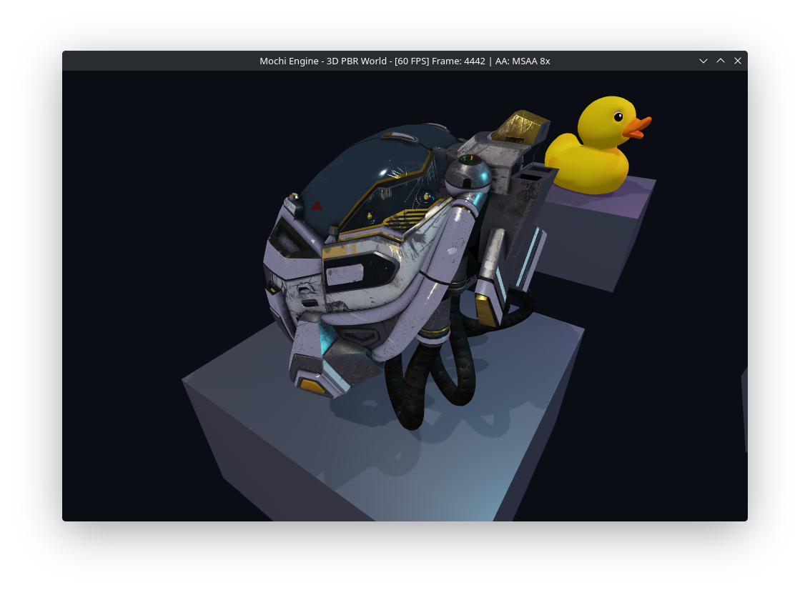
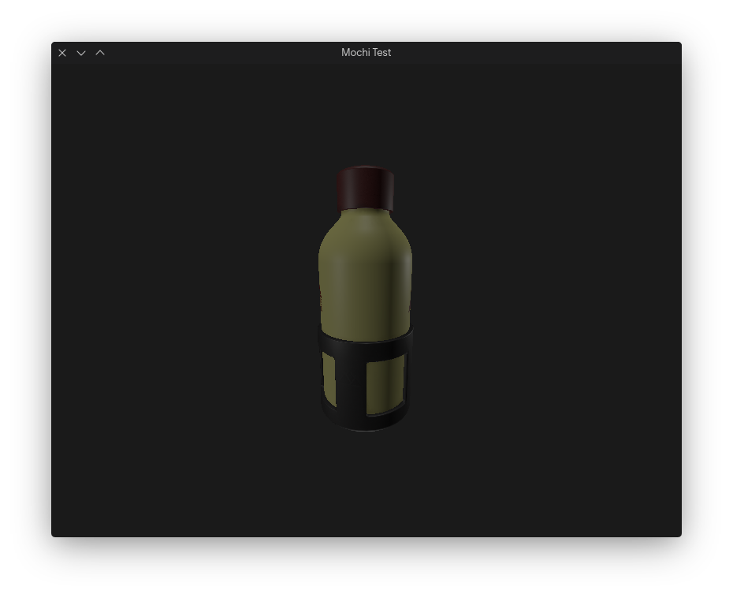
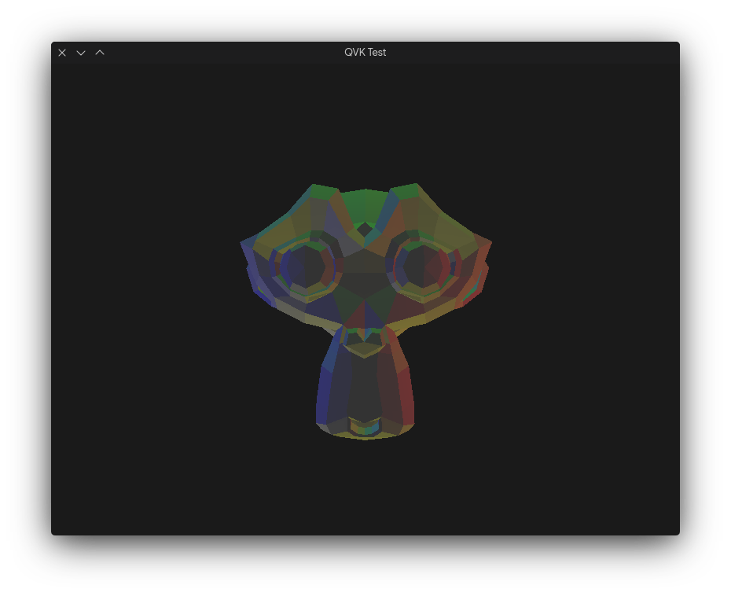

# Mochi

A modern, pure Rust 3D game engine and rendering framework.  
Developed under the **QAOS** umbrella, Mochi focuses on a clean, layered architecture, modern Vulkan 1.3+ graphics standards, memory safety, and data-oriented design.

Other languages: [tr](README.tr.md)

---

## Features

Mochi is designed from the ground up to embrace modern GPU architectures and idiomatic Rust:

* **Modern Vulkan 1.3+ RHI (`mochi_rhi_ash`):**
  * **Dynamic Rendering:** Eliminates legacy Vulkan `VkRenderPass` and `VkFramebuffer` boilerplate.
  * **Buffer Device Address (BDA):** Direct GPU pointer references for vertex and scene uniform data.
  * **Push Constants & Scalar Layout:** Fast, low-overhead data passing without complex descriptor sets.
* **Physically-Based Rendering (PBR):**
  * **Cook-Torrance BRDF:** GGX microfacet distribution, Smith geometric shadowing, and Schlick Fresnel approximation.
  * **Multi-Lighting Pipeline:** Supports up to 4 directional lights and 64 point lights with smooth windowed distance attenuation and ambient lighting.
  * **Modern PBR Material System:** Material templates, instances with property overrides, and GPU uniform buffer integration.
* **64-Bit Radix Sorted Render Queue:**
  * Draw calls are sorted using 64-bit Radix Sort keys encoding Pass Type, Translucency, Pipeline/Material hashing (minimizing GPU state changes), and Depth sorting (front-to-back for early-Z culling on opaque objects, back-to-front for alpha blending).
* **Data-Oriented ECS (`hecs`):**
  * Fast, cache-friendly archetype-based Entity Component System.
  * Built-in components: `TransformComponent`, `CameraComponent`, `DirectionalLightComponent`, `PointLightComponent`, `MeshRendererComponent`.
* **Data-Driven Asset & Scene System (`.masset` & `.mscene`):**
  * **RON (Rusty Object Notation):** Human-readable configuration and asset definition during development (`.masset.ron`, `.mscene.ron`, `mochi.ron`).
  * **Bincode:** Ultra-fast binary baking for zero-overhead release deployment.
  * Runtime instantiation directly into the `hecs::World`.
* **Cross-Platform Audio (`mochi_ahi_cpal`):**
  * Audio Hardware Interface with CPAL backend supporting ALSA, PulseAudio, JACK, WASAPI, and CoreAudio.

---

## Configuration (`mochi.ron`)

Engine parameters can be configured through `mochi.ron` in the project root:

```ron
ProjectConfig(
    name: "Mochi Engine",
    version: "0.1.0",
    window: WindowConfig(
        title: "Mochi Engine",
        width: 1280,
        height: 720,
        resizable: true,
        vsync: true,
    ),
    rendering: RenderingConfig(
        max_frames_in_flight: 2,
    ),
    scene: SceneConfig(
        start_scene: "assets/scenes/main.mscene.ron",
    ),
)
```

---

## Visuals


*PBR rendering test.*

  
*PBR rendering test.*

  
*PBR rendering test.*

---

## License

This project is licensed under the GNU General Public License version 3 (GPL3).

Copyright (c) 2025-2026 Kadir Aydın.

---

## QAOS

Built with ❤️ by the open source community.
