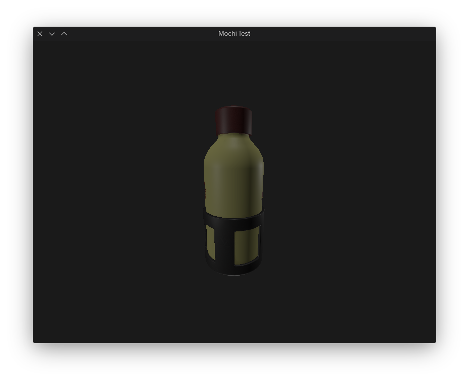
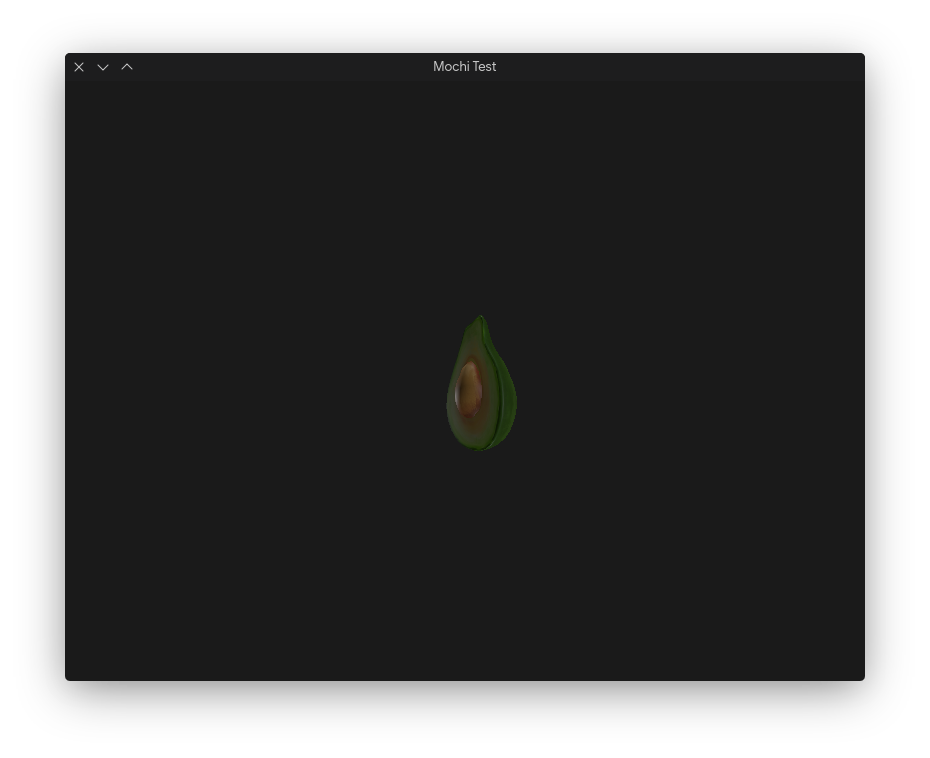
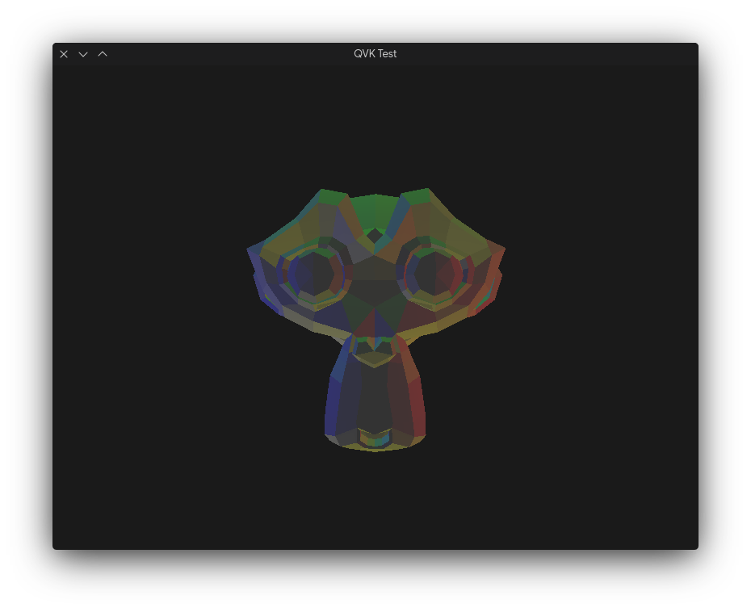

# Mochi

Modern ve saf Rust ile geliştirilen 3D oyun motoru ve render çerçevesi.  
**QAOS** çatısı altında geliştirilen Mochi; temiz, katmanlı bir mimariye, modern Vulkan 1.3+ grafik standartlarına, bellek güvenliğine ve veri odaklı tasarıma odaklanır.

Diğer diller: [en](README.md)

---

## Özellikler

Mochi, modern GPU mimarilerini ve Rust dilinin gücünü en üst düzeyde kullanacak şekilde sıfırdan tasarlanmıştır:

* **Modern Vulkan 1.3+ RHI (`mochi_rhi_ash`):**
  * **Dinamik Render (Dynamic Rendering):** Eski nesil `VkRenderPass` ve `VkFramebuffer` kalabalığını ortadan kaldırır.
  * **Buffer Device Address (BDA):** Vertex ve sahne verilerine doğrudan 64-bit GPU adresleri üzerinden hızlı erişim.
  * **Push Constants & Skaler Yerleşim:** Ağır descriptor set yükü olmadan anlık veri transferi.
* **Fiziksel Tabanlı Render (PBR):**
  * **Cook-Torrance BRDF:** GGX mikro yüzey dağılımı, Smith geometrik gölgelemesi ve Schlick Fresnel yaklaşımı.
  * **Çoklu Işıklandırma Hattı:** Yumuşak mesafe düşüşü ve ortam aydınlatması ile 4 yönsel ışık (Directional Light) ve 64 nokta ışık (Point Light) desteği.
  * **Modern PBR Materyal Sistemi:** Materyal şablonları (Templates), özellik geçersiz kılmalı örnekler (Instances) ve GPU Uniform Buffer entegrasyonu.
* **64-Bit Radix Sort Sıralı Render Kuyruğu:**
  * Çizim çağrıları 64-bit Radix Sort anahtarlarıyla sıralanır: Geçiş türü (Pass Type), Saydamlık (Translucency), GPU durum değişimlerini en aza indiren Pipeline/Materyal karma değeri (Hashing) ve Derinlik (Early-Z optimizasyonu için opak nesnelerde önden-arkaya, saydam nesnelerde arkadan-öne).
* **Veri Odaklı ECS (`hecs`):**
  * Hızlı, önbellek dostu (cache-friendly) arketip tabanlı Varlık Bileşen Sistemi.
  * Yerleşik bileşenler: `TransformComponent`, `CameraComponent`, `DirectionalLightComponent`, `PointLightComponent`, `MeshRendererComponent`.
* **Veri Odaklı Varlık ve Sahne Sistemi (`.masset` & `.mscene`):**
  * **RON (Rusty Object Notation):** Geliştirme sürecinde ve versiyon kontrolünde kolay okunan insan dostu yapılandırma (`.masset.ron`, `.mscene.ron`, `mochi.ron`).
  * **Bincode:** Dağıtım sürümleri için sıfır maliyetli ve ultra hızlı binary derleme.
  * `hecs::World` içine doğrudan çalışma zamanı sahne örneklendirme (instantiation).
* **Platformlar Arası Ses Desteği (`mochi_ahi_cpal`):**
  * ALSA, PulseAudio, JACK, WASAPI ve CoreAudio destekli saf Rust CPAL ses backend'i.

---

## Yapılandırma (`mochi.ron`)

Motor parametreleri proje kökündeki `mochi.ron` dosyası üzerinden ayarlanabilir:

```ron
ProjectConfig(
    name: "Mochi Engine",
    version: "0.1.0",
    window: WindowConfig(
        title: "Mochi Engine",
        width: 1280,
        height: 720,
        resizable: true,
        vsync: true,
    ),
    rendering: RenderingConfig(
        max_frames_in_flight: 2,
    ),
    scene: SceneConfig(
        start_scene: "assets/scenes/main.mscene.ron",
    ),
)
```

---

## Görseller

  
*PBR render testi.*

  
*PBR render testi.*

  
*PBR render testi.*

---

## Lisans

Bu proje GNU Genel Kamu Lisansı sürüm 3 (GPL3) altında lisanslanmıştır.

Telif Hakkı (c) 2025-2026 Kadir Aydın.

---

## QAOS

Açık kaynak topluluğu tarafından ❤️ ile geliştirildi.
